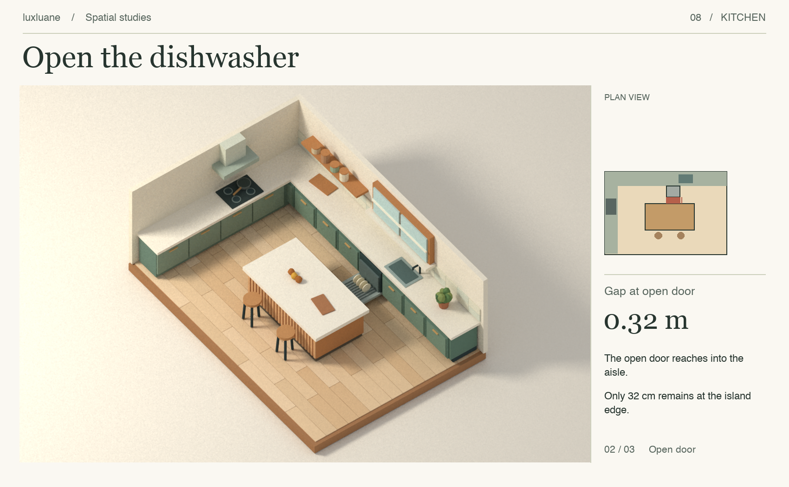
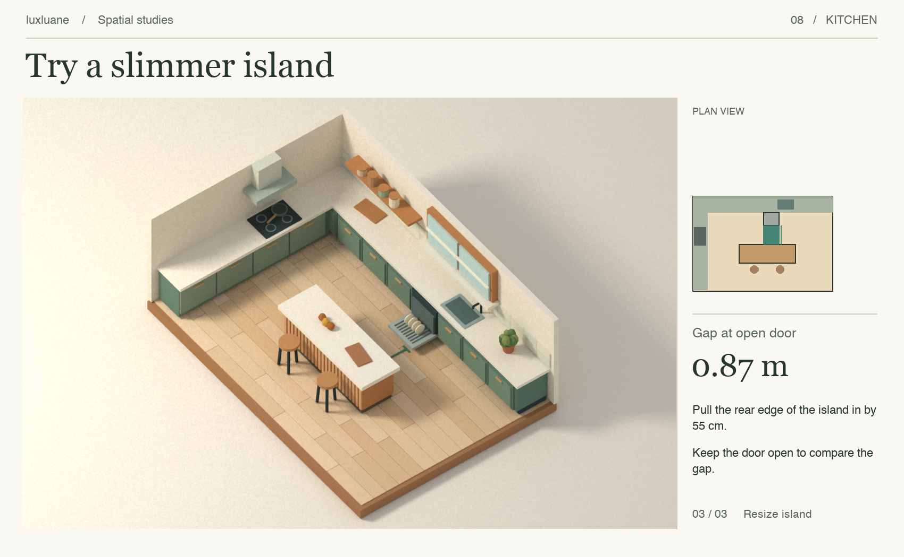
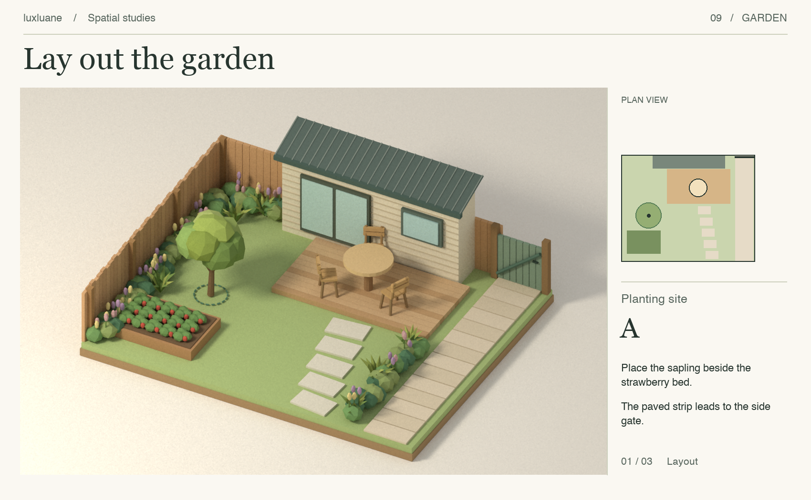
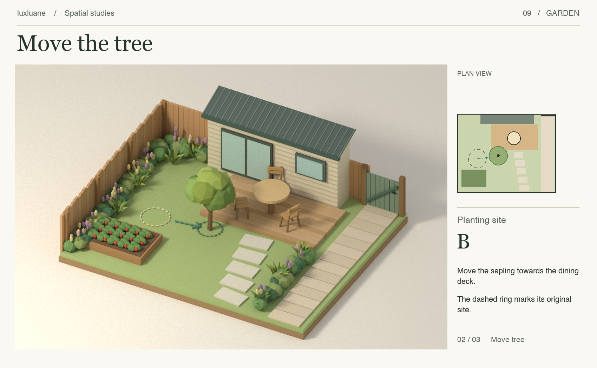
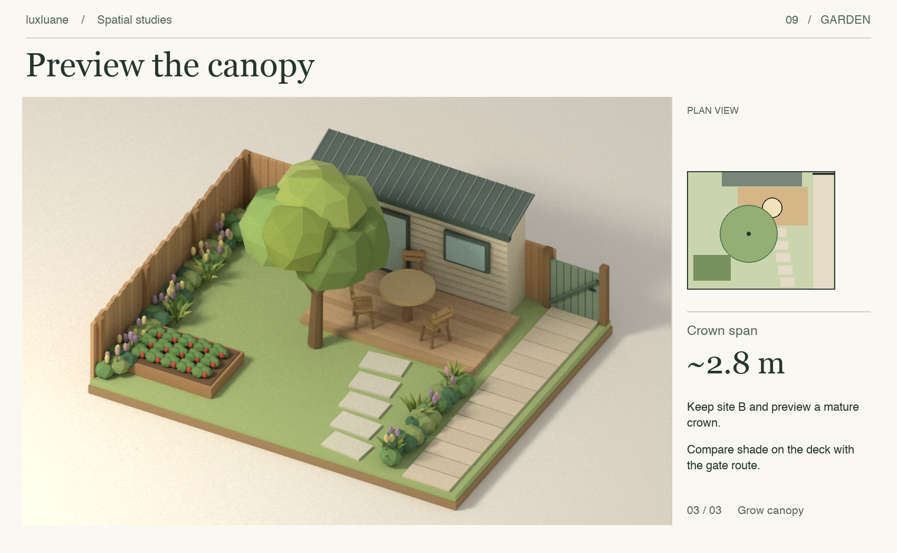

# Demo-3d
Independent demo repository for [Group-Internship](https://github.com/STERILITZIA02/Group-Internship).

Six low-fidelity 3D views explore two candidate project briefs. Read each row
from left to right. Open an image to inspect the model and its plan at full size.

### 08 · Kitchen design and visualisation

| Lay out the kitchen | Open the dishwasher | Try a slimmer island |
| --- | --- | --- |
| [](prototypes/views/kitchen-01.png) | [](prototypes/views/kitchen-02.png) | [](prototypes/views/kitchen-03.png) |

The rear cabinets and the island's seating edge stay in place. Pulling its worktop
back by 55 cm gives the cook that much more room to pass the open dishwasher.
The dimensions describe this model.

### 09 · Landscape and garden planning

| Lay out the garden | Move the tree | Preview the canopy |
| --- | --- | --- |
| [](prototypes/views/garden-01.png) | [](prototypes/views/garden-02.png) | [](prototypes/views/garden-03.png) |

Follow the same tree from the strawberry bed to the deck, then compare its
grown crown under the same light. Growth and shadows illustrate the design
decision; species, season and site-specific sun angles are still open.

### Render the studies

The editable [scene models](prototypes/scenes/) use metres, with Z up. From
the demo root, run the following in a Python 3.12 virtual environment:

```sh
python -m pip install -r prototypes/requirements.txt
python prototypes/scenes/render.py
```

To render a single state, add `--theme kitchen --step 2` or
`--theme garden --step 3`. The image sheets use a fixed camera per brief.
An interactive application and its technology stack are still to be agreed.

## Setup placeholders

| Item | Value |
| --- | --- |
| Demo objective and audience | Help the internship team compare kitchen circulation and garden planting layouts |
| Scope and acceptance criteria | To be agreed |
| Stack and dependencies | To be chosen |
| Install / run / build commands | To be added |
| Tests and verification | To be added |
| Preview / deployment URL | To be added if needed |
| Version | To be set by the project owner |

## Working on this demo

Plan work on the [main Sprint board](https://github.com/users/STERILITZIA02/projects/2).
Create a task branch here and reference the main planning issue in the PR.
After merging, update this demo's submodule reference in the main repository.
See the [workflow guide](https://github.com/STERILITZIA02/Group-Internship/blob/main/docs/sprint-workflow.md).

The current Repository checks workflow only checks whitespace and checkout;
application checks will be added with the chosen stack.

All rights reserved. See [LICENSE](LICENSE).
