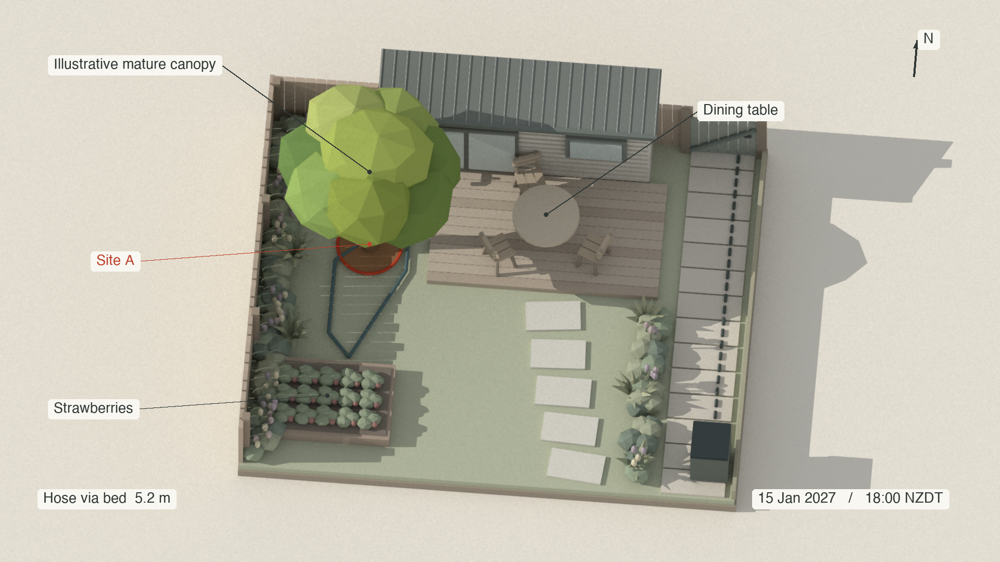
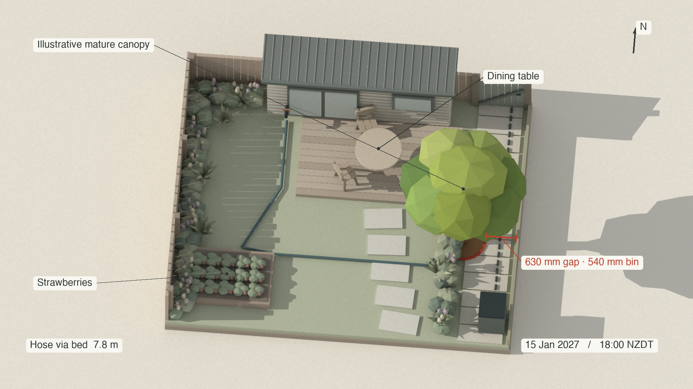

# Garden scene studies

One Auckland courtyard model, rendered from a fixed camera. Moving the same mature tree from the table to the fence shows how evening shade, bin clearance and the route from the tap change.

| Beside the table | Beside the fence |
| --- | --- |
| [](prototypes/pitch-778/G2-table.png) | [](prototypes/pitch-778/G3-fence.png) |

[Yard layout](prototypes/pitch-778/G1-yard.png) · [Established roots, in section](prototypes/pitch-778/G4-established-roots.png)

## Render the garden

From the repository root, create a Python 3.12 environment and install the [rendering dependencies](prototypes/requirements.txt):

```sh
python3.12 -m venv .venv
. .venv/bin/activate
python -m pip install -r prototypes/requirements.txt
python prototypes/scenes/render_pitch.py --samples 60 --only G1-yard G2-table G3-fence
python prototypes/scenes/render_root_study.py
```

The scripts write 1920 × 1080 PNGs to [`prototypes/pitch-778/`](prototypes/pitch-778/). Scene coordinates are in metres, with east along X, north along Y and height along Z. [Scene geometry](prototypes/scenes/pitch_models.py) · [Camera and sunlight](prototypes/scenes/render_pitch.py)

## Other studies

For a new garden comparison, start with the courtyard in [pitch_models.py](prototypes/scenes/pitch_models.py). Keep the camera, sun, yard and output size fixed across the pair. Move the feature under study and label the detail the viewer should compare. For a separate shot, [the root study](prototypes/scenes/render_root_study.py) shows how to reuse the camera and renderer with a different model. Give the new PNG its own filename and add its render command here.

| Study | Files | Render command |
| --- | --- | --- |
| Kitchen island clearance | [Room](prototypes/pitch-778/K1-measured.png) · [Wide island](prototypes/pitch-778/K2-wide-open.png) · [Narrow island](prototypes/pitch-778/K3-narrow-open.png) | `python prototypes/scenes/render_pitch.py --samples 60 --only K1-measured K2-wide-open K3-narrow-open` |
| Early garden and kitchen layouts | [Six views](prototypes/views/) | `python prototypes/scenes/render.py` |

[Garden planner](https://github.com/STERILITZIA02/Group-Internship) · [Contributing](https://github.com/STERILITZIA02/Group-Internship/blob/main/CONTRIBUTING.md) · [License](LICENSE)

[Sprint plan](https://github.com/STERILITZIA02/Group-Internship/wiki/Sprint-Plan#sprint-schedule) · [Daily stand-ups](https://github.com/STERILITZIA02/Group-Internship/wiki/Daily-Stand-ups) · [Sprint meetings](https://github.com/STERILITZIA02/Group-Internship/wiki/Meeting-Log#sprint-meetings)
